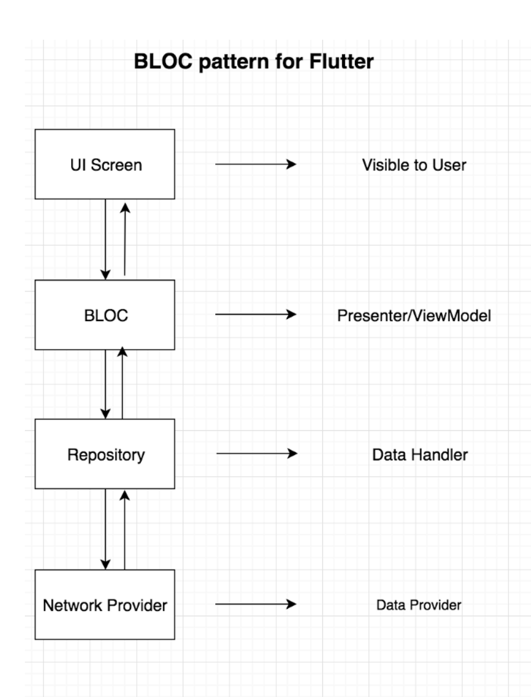
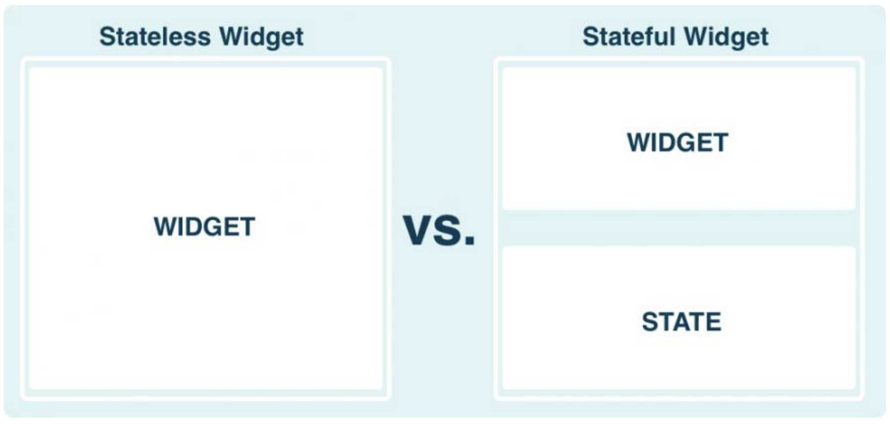
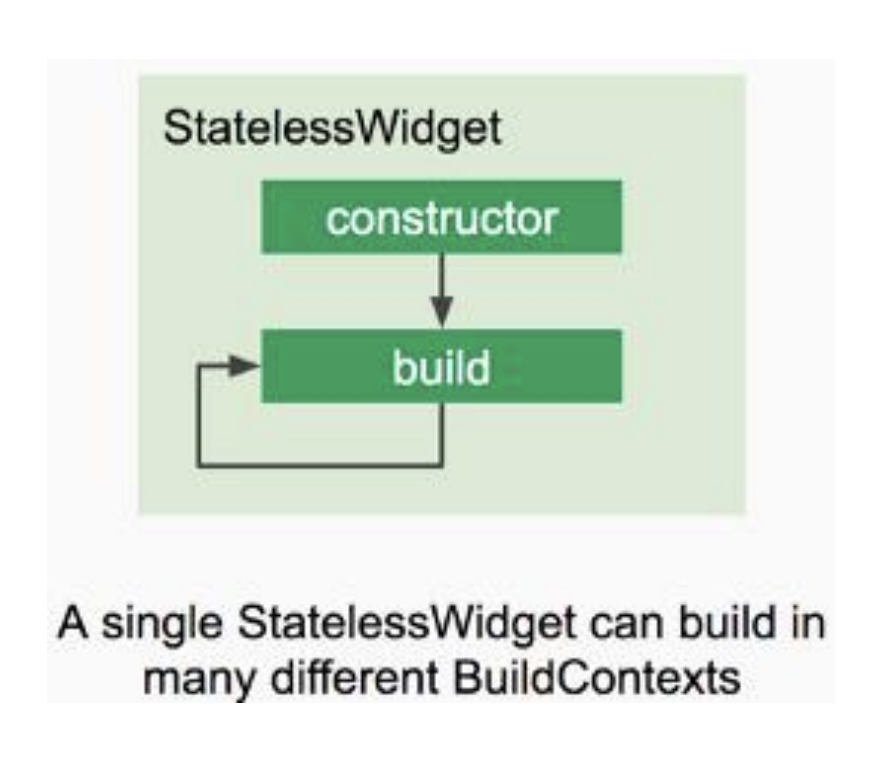
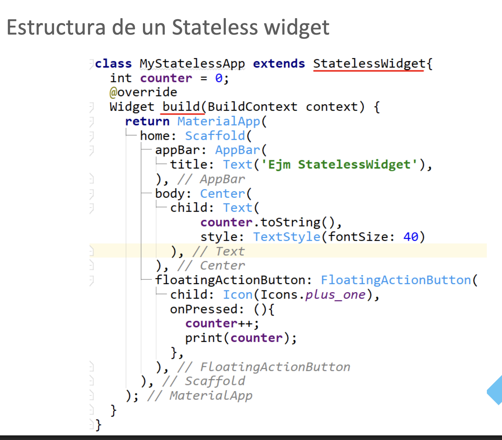
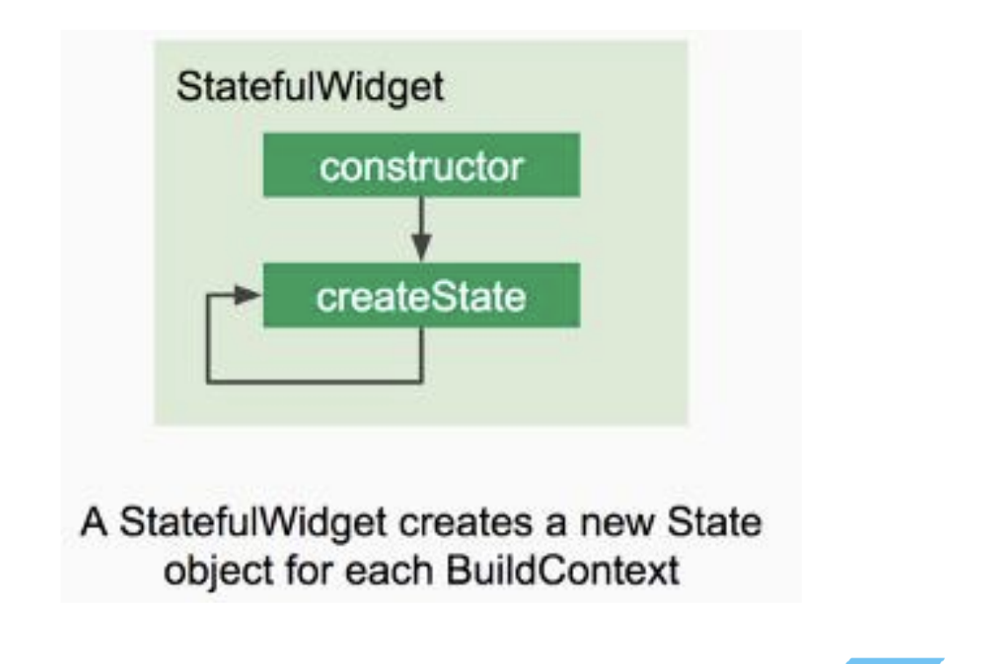
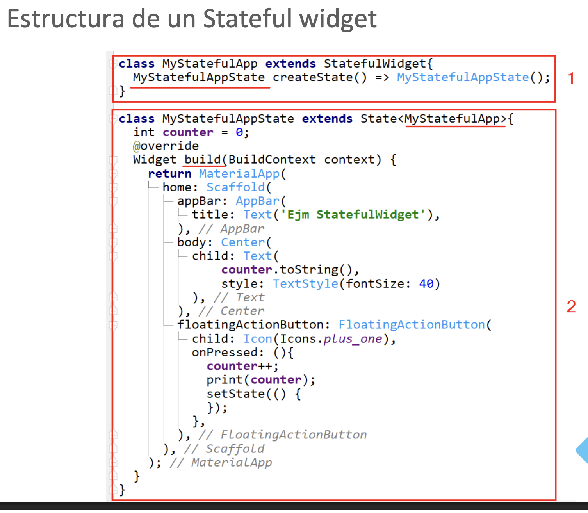
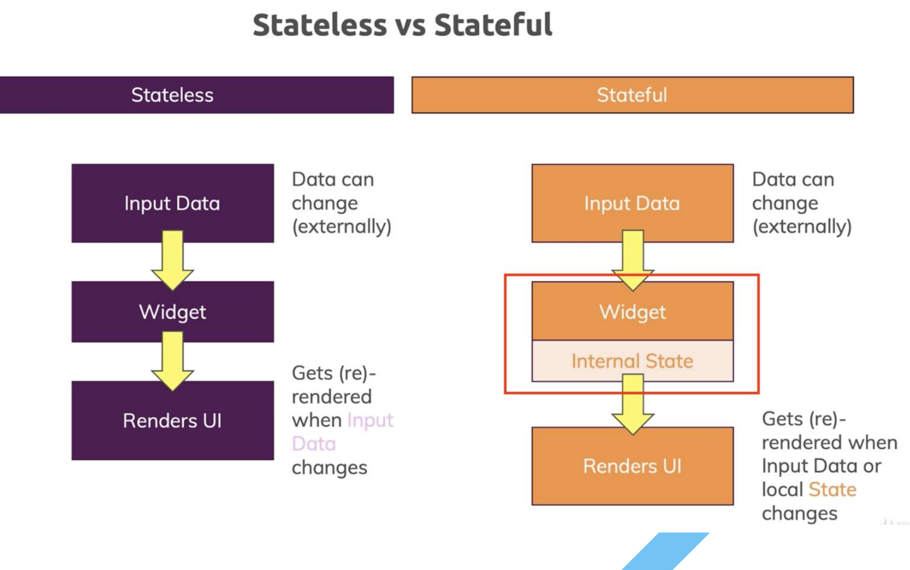

# *cross-platform mobile  - Gui (complemento Oreilly)*

**Dart**

Dart no es reemplazar a JavaScript como el principal lenguaje de programación web en los navegadores, sino ofrecer una alternativa más moderna.

Dart se puede ejecutar de dos maneras: 
- En una máquina virtual (MV),
- o en un motor de Javascript utilizando un compilador para traducir el código.
Esto le permite adaptarse a cualquier navegador.

**¿Por qué Flutter usa Dart?**

- El primer equipo de Flutter evaluó más de una docena de lenguajes de
programación y eligió Dart porque coincidían con la forma en que se
construían las interfaces de usuario en Flutter.

- Dart es AOT (Ahead Of Time) compilado en un código nativo rápido,
predecible, que permite que casi todo Flutter se escriba en Dart. Esto no
solo hace que Flutter sea rápido, sino que prácticamente todo (incluidos
todos los widgets) se puedan personalizar.

- Dart también se puede compilar JIT (Just In Time) para ciclos de
desarrollo excepcionalmente rápidos y un flujo de trabajo cambiante
(incluido el hot reload).

- Dart facilita la creación de animaciones y transiciones suaves que se
ejecutan a 60 fps. Dart puede hacer la asignación de objetos y la
recolección de basura sin bloqueos. Y al igual que JavaScript, Dart evita la
programación preventiva y la memoria compartida (y, por lo tanto, se
bloquea). Las aplicaciones Flutter se compilan en código nativo.

- Flutter no necesita de jsx o xml ya que proporciona herramientas

**Flutter**

- Flutter es el framework mientras que dart es el lenguaje
- cross-platform
- La arquitectura que se emplea es de patron de disenio es BLOC similar a MVP Y MVVM

# **Widget**

Flutter tiene dos tipos de widgets:

• STATELESS WIDGETS

• STATEFUL WIDGETS

Estos dos tipos de widgets son los bloques de construcción con los que trabaja flutter.

Estado es algo que puede cambiar dentro de un widget.

Por ejemplo, si tenemos un botón, puede hacer una acción dependiendo
si hizo clic en él. Ese es un estado. El estado (acción) de ese botón puede
cambiar. Si un widget es constante y no cambia sin importar lo que se
haga, entonces no tiene un Estado.

**Stateless y Stateful.**

• Stateless significa que no tiene estado.
• Stateful significa que cambiará de estado.

## Stateless widget

Los Stateless widgets no tienen estado. Son widgets que pueden mostrar
o hacer lo mismo todo el tiempo. No cambian la forma en que se
comportan durante el tiempo de ejecución.

## Statelful widget

Un stateful widget es dinámico: por ejemplo, este puede cambiar su
apariencia en respuesta a eventos desencadenados por la interacción del
usuario o cuando recibe datos.
Checkbox, Radio, Slider, InkWell, Form, y TextField 

## Comparison 

## Good practices 

Una buena práctica a seguir al escribir widgets es tratar de tener la
menor cantidad posible de Stateful widgets. Escriba su código utilizando
solo Stateless widgets y agregue Stateful widgets UNICAMENTE donde
vea la necesidad.
Por ejemplo, si en su pantalla tiene un texto que nunca cambiará y un
botón que cambiará, no es necesario que todo esté en un Stateful
widget. Solo el botón debe necesitar estado.

**Develop**

- se usara lib para las carpetas domain, presentation. data
- el gradel es en pubspec.yaml, donde al entrar en pub.dev se pega en dependencies , lo mismo hago con el sqflite
